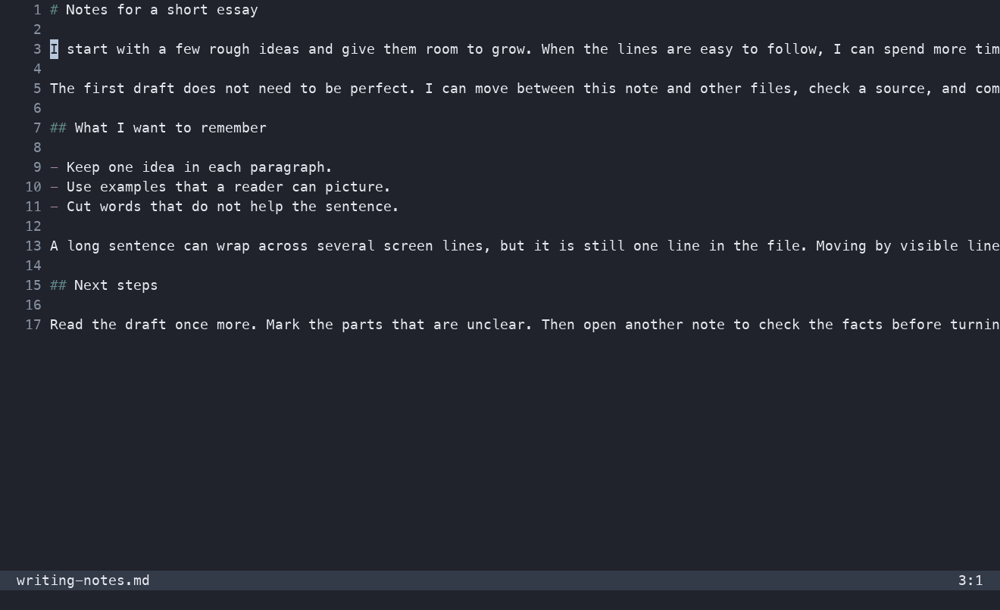
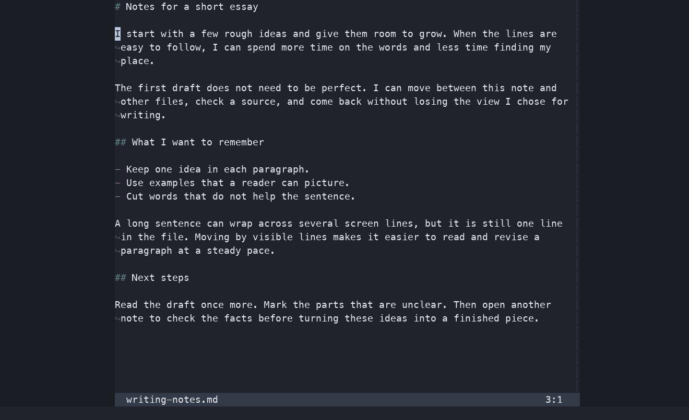

# `zenon.nvim`

`zenon.nvim` adds a zen mode to Neovim for reading and writing. It centers
text at a comfortable width and lets you move through wrapped lines as they
appear on screen. Enable it for a buffer, then open other files, splits, or a
sidebar. That buffer stays in zen mode when you return.

The same dummy note in a 120-column Neovim window:

| Without `zenon.nvim` | With `zenon.nvim` |
| --- | --- |
|  |  |

## Install

Requires Neovim 0.12 or newer.

With `lazy.nvim` or `LazyVim`:

```lua
return {
  {
    "damianmr/zenon.nvim",
    tag = "v1.0.0",
    main = "zenon",
    cmd = { "Zenon", "Zenoff" },
    opts = {},
  },
}
```

With Neovim's native package manager:

```lua
vim.pack.add({
  { src = "https://github.com/damianmr/zenon.nvim", version = "v1.0.0" },
})
require("zenon").setup({}) -- Optional with the default settings.
```

Both examples install the published
[`v1.0.0` release](https://github.com/damianmr/zenon.nvim/releases/tag/v1.0.0).

## Use

| Command | What it does |
| --- | --- |
| `:Zenon` | Enable the current buffer, or resize it with its current settings. |
| `:Zenon 60` | Request 60% of each split that shows the buffer. |
| `:Zenon 60 80` | Request 60%, with a minimum of 80 text columns. |
| `:Zenon 60 80 120` | Request 60%, with a minimum of 80 and a maximum of 120 text columns. |
| `:Zenoff` | Disable the current buffer. |
| `:Zenoff!` | Disable all enabled buffers. |

The command order is percentage, minimum, maximum. The default is 50%, with a
minimum of 80 text columns and no maximum. With one split and no gutters:

| Split width | 50% | Text width |
| --- | ---: | ---: |
| 120 columns | 60 columns | about 80 columns |
| 200 columns | 100 columns | about 100 columns |

On a 120-column split, 50% is 60 columns, so the minimum makes the text about
80 columns wide. The percentage includes the text window and its margins.
Gutters, such as line numbers, can reduce the space for text. If the split is
too narrow for the minimum, `zenon.nvim` uses the width available.

## What to expect

- Your file stays in its editing window. Blank windows form the margins.
- Text is centered inside each split. If a buffer appears in several windows,
  each window gets its own width.
- Buffers stay enabled when you switch files. Their margins return when you
  switch back.
- Other splits and sidebars, such as `nvim-tree`, stay usable.
- Long lines wrap on screen. In normal mode, `j` and `k` move by visible rows.
- File contents, undo history, formatting, and spell checking stay the same.
- On disable, `zenon.nvim` restores options and mappings that still match what
  it set. It keeps changes you made later.
- Margins are real windows, visible to `:windo` and window pickers. Filter
  `filetype=zenon-margin` in tools that should skip them.

## Configure

Default settings:

```lua
require("zenon").setup({
  -- Percentage uses the split and its margins, minus retained gutters.
  width = 50,             -- Percentage, greater than 0 and at most 100.
  min_width = 80,
  max_width = nil,        -- Text columns; nil or false means no maximum.

  -- Wrapping and movement change the display, not the file contents.
  showbreak = "↪",       -- Marker on wrapped rows; false hides it.
  scrolloff = 10,         -- Rows of context above and below the cursor.
  breakindent = true,     -- Keep indentation on wrapped rows.
  wrap = true,           -- Wrap long lines on screen.
  linebreak = true,       -- Wrap at word boundaries.
  wrap_navigation = true, -- Normal-mode j/k move by visible rows, with counts.

  -- Appearance.
  hide_eob = true,        -- Hide ~ markers after the end of the buffer.
  dim = 0.15,             -- Darken margins: 0 to 1, or false to disable.
  ruler = false,          -- Hide Neovim's global cursor-position ruler.
  window_options = {
    number = false,       -- Hide line numbers.
    relativenumber = false,
    signcolumn = "no",     -- Hide the sign column.
    foldcolumn = "0",      -- Hide the fold column.
    list = false,         -- Hide whitespace markers.
    cursorline = false,   -- Hide cursor-line highlighting.
    cursorcolumn = false, -- Hide cursor-column highlighting.
  },

  integrations = {
    lualine = true,       -- Hide margin titles in an already loaded lualine.
  },
  hooks = {},            -- Optional callbacks, described below.
})
```

Setup is optional. Pass overrides to `setup()` or your plugin spec's `opts`.

`min_width` and `max_width` are positive integers in text columns, with
`max_width >= min_width`. Narrow splits use the available space.
`scrolloff` is a nonnegative integer.

`window_options` accepts window-local Neovim options and takes priority over
the display settings above. Use
`window_options = { spell = true, number = true }` to enable spell checking
and keep line numbers. Omitted entries keep their defaults. `zenon.nvim`
restores window options when leaving a view and buffer mappings on disable.
It keeps later user changes.

Existing buffer-local `j`/`k` mappings take priority over `wrap_navigation`.
Set `wrap_navigation = false` to keep your configured movement. `ruler` is
global; `zenon.nvim` restores it after the last buffer is disabled.
It leaves `showcmd` and statuslines alone.

The `lualine` adapter hides margin winbars and window statuslines while keeping
file titles and the global statusline. It requires an already loaded `lualine`.
Set `integrations = { lualine = false }` to disable it. Enable registered
custom adapters by name in `integrations`.

`hooks` accepts these callbacks:

| Callback | When it runs |
| --- | --- |
| `on_enable = function(ctx) ... end` | Once per enabled buffer, after its views are created. May return a cleanup function that receives context when the session ends. |
| `on_disable = function(ctx) ... end` | After the buffer's session resources are removed. |
| `on_resize = function(ctx) ... end` | After a view is created or its geometry changes. |

Each callback receives `ctx.bufnr`, `ctx.reason`, `ctx.session_count`, and
`ctx.windows`. Each window entry has `winid`, `width`, and `available`.
The window list can be empty for hidden buffers or after disable. Hooks must
not enable, disable, or reconfigure `zenon.nvim`.

For per-buffer overrides, use `require("zenon").enable({ width = 60 })`.
Use `{ max_width = false }` to clear an inherited maximum. Runtime overrides
take priority over setup defaults and are cleared on disable.

See [the help file](doc/zenon.txt) or `:help zenon` for the full Lua API,
custom adapter callbacks, and the margin contract.

## Development and license

Run `make test` for headless Neovim tests and `make check` for formatting.
`zenon.nvim` uses the [MIT license](LICENSE) and has no required runtime
dependencies.

## Compared with other plugins

### [`zen-mode.nvim`](https://github.com/folke/zen-mode.nvim)

- `zenon.nvim` stays enabled for a buffer when you use other splits or open
  `nvim-tree`.
  `zen-mode.nvim` opens one floating window. It closes when you enter a normal
  split.
- `:Zenon 60` sets the percentage from the command line. `:ZenMode` has no width
  argument. You can set its width in the config or through Lua.
- `zen-mode.nvim` can change terminal or GUI settings through its integrations.
  `zenon.nvim` leaves those settings alone. You can use hooks to change them yourself.

### [`zen.nvim`](https://github.com/sand4rt/zen.nvim)

- `zenon.nvim` is enabled per buffer. `zen.nvim` starts its layout after setup.
- `zen.nvim` centers one main buffer and can put sidebars around it.
  `zenon.nvim` centers text inside each editing split. With a sidebar open,
  `zenon.nvim` does not keep the file centered on the whole screen.
- Both allow splits. With several vertical splits, `zen.nvim` removes its
  centering margins. `zenon.nvim` keeps margins for enabled windows when space
  allows.
- `zenon.nvim` uses a percentage of each split, with optional minimum and
  maximum text widths. `zen.nvim` uses a main width in columns or a Lua function.
- `zen.nvim` can place sidebars by filetype on the left, right, top, or bottom.
  `zenon.nvim` leaves sidebar placement to you or the sidebar plugin.
